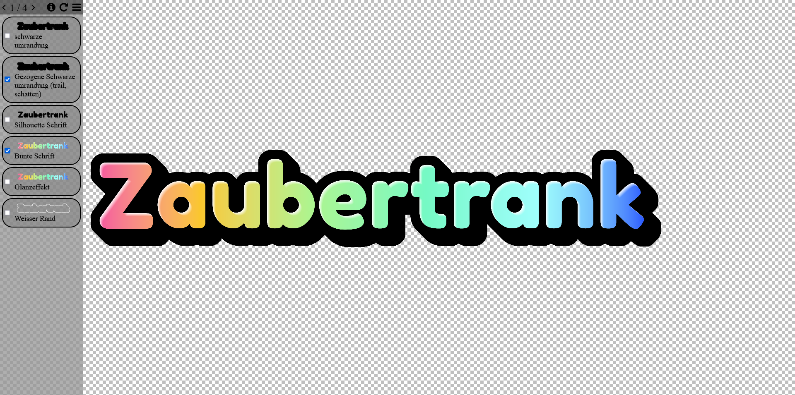

# pdnwebview

Show [Paint.NET](https://www.getpaint.net/) `.pdn` project files in a browser.

pdnwebview is a **static** viewer: plain HTML/CSS/JavaScript with WebGL canvas
rendering. It has **no upload form, no API and no server-side processing at
runtime**. Files are converted ahead of time by the offline
[`pdnexport` CLI](https://gitlab.com/christianbrinkmann/pdnexport) into a plain
folder structure under `data/`, and this repo renders those folders.

Live demo: <https://christian-f-brinkmann.de/paint/?id=testimage>



## How it works

```text
artwork.pdn  --pdnexport-->  data/artwork/  --static files-->  pdnwebview (browser)
                             info.json, status.txt, full.png,
                             <n>.png / .json / .blob / _b.png / _thumbnail.png
```

A project is addressed by URL query parameters: one `id` per project folder
name.

## Requirements

- git
- Python 3 (only for exporting and for the local preview server)
- a modern browser with WebGL
- Paint.NET on Windows to create `.pdn` files

## Setup

Clone the viewer **with submodules** (`lib/Canvas2DtoWebGL`, the WebGL canvas
emulation, is a pinned git submodule):

```bash
git clone --recurse-submodules https://github.com/chrisb09/pdnwebview.git
cd pdnwebview
```

Already cloned without submodules?

```bash
git submodule update --init --recursive
```

Clone and set up the exporter:

```bash
git clone https://gitlab.com/christianbrinkmann/pdnexport.git ../pdnexport
python3 -m venv ../pdnexport/.venv
../pdnexport/.venv/bin/pip install -r ../pdnexport/requirements.txt
```

On Windows use `py -m venv .venv` and `.venv\Scripts\pip install -r requirements.txt`.

## Export projects

Export one file (creates `data/<file-stem>/`):

```bash
../pdnexport/.venv/bin/python ../pdnexport/pdnexport.py artwork.pdn data
```

Export every `.pdn` in a folder, recursively:

```bash
../pdnexport/.venv/bin/python ../pdnexport/pdnexport.py ~/paint-projects data --folder
```

The viewer **ID** of a project is its output folder name — the source file
name without `.pdn`. IDs are case-sensitive and must be URL-encoded in links
(spaces become `%20`).

## Preview locally

```bash
python3 -m http.server 8000
```

Then open:

```text
http://localhost:8000/?id=artwork
http://localhost:8000/?id=artwork&id=logo     # queue of several projects
```

Opening without `id` shows an alert explaining the expected URL.

## Controls

- sidebar: layer list with thumbnails; click a layer to toggle its visibility
- `<` / `>`: previous/next project in the `id` queue
- mouse wheel / drag / pinch: zoom and pan
- top-right icon: fullscreen
- info panel: file metadata and a link to the flattened `full.png`

## Embedding

```html
<iframe src="https://example.com/paint/?id=artwork"
        title="Paint.NET project"
        style="width:1280px;height:720px;border:0;overscroll-behavior:contain"
        allowfullscreen></iframe>
```

## Deployment

Any static file server works (nginx, Apache, Caddy, `python3 -m http.server`,
GitHub Pages, ...). Copy the repo contents **and** the `data/` folder to the
web root:

```text
/var/www/paint/
  index.html
  drawCanvas.js
  style.css
  loading_bar.css
  lib/...
  res/...
  data/<project-id>/...
```

There is no Python or Node runtime in production. If `data/` is served from
another origin it needs CORS headers, because the viewer fetches the files
from JavaScript.

Example nginx location:

```nginx
location /paint/ {
    alias /var/www/paint/;
    try_files $uri $uri/ =404;
}
```

## Data layout

For each exported project `data/<id>/`:

| file | purpose |
|---|---|
| `info.json` | canvas size, timestamps, exporter version |
| `status.txt` | `0` while exporting, layer count when done |
| `version.txt` | exporter version that produced the folder |
| `hash.txt` | MD5 of the source `.pdn` (cache key) |
| `full.png` | flattened preview |
| `<n>.png` | layer image |
| `<n>.json` | layer name, visibility, opacity, blend mode, center of mass, bounding box |
| `<n>.blob` | packed 1-bit opacity map for click hit-testing |
| `<n>_b.png` | border/outline overlay |
| `<n>_thumbnail.png` | sidebar thumbnail |

Re-exporting the same `.pdn` is skipped when `hash.txt` + `version.txt` match
and the previous export finished; delete the folder to force a rebuild.

## Troubleshooting

| symptom | cause / fix |
|---|---|
| 404 for `lib/Canvas2DtoWebGL/...`, blank canvas | submodule missing — run `git submodule update --init --recursive` |
| `AttributeError: ... ANTIALIAS` during export | old exporter with Pillow ≥ 10 — use pdnexport 1.0.10+ |
| pip error about `shutil` / `hashlib` etc. | old `requirements.txt` — use pdnexport 1.0.10+ |
| alert “No project names via the id parameter” | add `?id=<folder>` |
| 404 for `data/<id>/info.json` | wrong ID, case mismatch, or project not exported |
| large projects take minutes / lots of RAM | the exporter loops per pixel in Python; expected |
| layers render in normal blend mode | blend modes are stored but not reproduced |

## Limitations

- read-only — no editing
- blend modes are not reproduced (all layers render “normal”)
- only `.pdn` files supported by PyPdn
- no animation support

## License

MIT — see [LICENSE.md](LICENSE.md).
